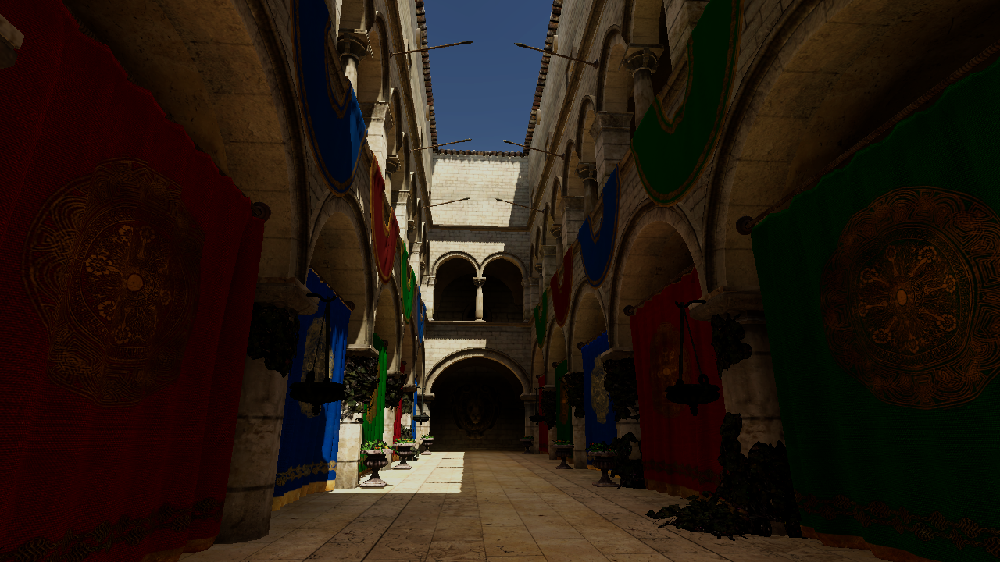
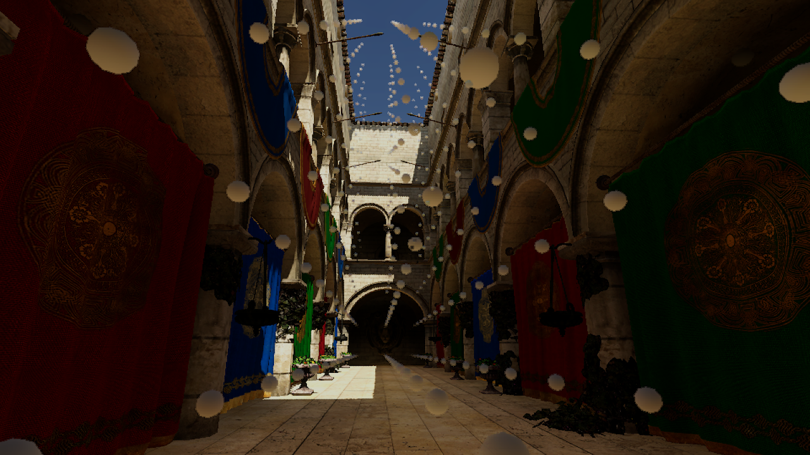

# FraxinusGraphics Demo

[English](README.md) | [简体中文](README.zh-CN.md)

基于 **Unity 2022.3.62f3** 与 [FraxinusGraphics](https://github.com/bluewhitebow/FraxinusGraphics) 的 Sponza 渲染示例。在同一场景体验 **APRTV 动态重光照**、**GI 与探针调试**、**级联阴影缓存**和 **STP / SGSR 升采样**。工程包含材质、渲染预设，以及 **4,563 个探针**的预计算传输数据。



## 打开工程

安装 Git，确保终端能运行 `git --version`，然后克隆 Demo：

```bash
git clone https://github.com/bluewhitebow/FraxinusGraphicsDemo.git
```

1. 在 Unity Hub 中添加克隆的目录，使用 **2022.3.62f3** 打开。
2. 等待依赖解析、资源导入与 Shader 编译完成。
3. 打开 `Assets/FraxinusSponza/Scenes/Sponza.unity`，或使用菜单 **Fraxinus > Sponza > Open Demo**。
4. 进入 Play 模式，演示面板会显示，已有探针数据会自动加载。

Unity 会直接从 GitHub 下载四个渲染包。目前 FraxinusGraphics 仍为私有仓库，打开工程前，账号须有该仓库的访问权限，且本机 Git 已配置认证。

## 演示操作

| 操作 | 效果 |
| --- | --- |
| APRTV indirect lighting / GI only | 对比间接光开关，或单独查看 GI 贡献。 |
| Show probes | 在烘焙探针位置显示小球，并按光照响应着色。 |
| Cache distant shadow cascades | 切换两种阴影预设。修改投影物体后，可点击 **Refresh shadow cache** 主动刷新。 |
| Native / STP / SGSR1 / SGSR2 | 对比原生分辨率与 `0.75` 渲染比例的重建效果；时域模式开启后处理并关闭 MSAA。 |
| Sun rotation | 旋转方向光，使用已有几何传输数据重新计算光照。 |
| `1` / `2` | 切换庭院或二层机位。 |
| 按住鼠标右键 + `WASD`、`Q` / `E` | 自由移动相机，按住 `Shift` 加速。 |
| `H` / `Esc` | 隐藏面板 / 释放鼠标。 |
| Reset demo | 恢复初始机位、太阳、光照与渲染预设。 |

停止 Play 模式后恢复原渲染资产引用，升采样的实际可用性取决于图形设备。



探针小球显示烘焙位置与光照响应，可独立于 GI 视图开关。

## 关联外部包

[`Packages/manifest.json`](Packages/manifest.json) 通过 Git 直接引用 RPCore、URPExtensions、URPGlobal 和 Light Transport，统一固定在 [FraxinusGraphics 提交 `f48668c`](https://github.com/bluewhitebow/FraxinusGraphics/commit/f48668c738d5d219d98fbb77feac7f4b5def26da)。无需相邻仓库目录或子模块；修改本机另一份源码不会自动影响此 Demo。

更新包时，先推送渲染代码，再同步更新四处提交号；验证 Demo 后，将 manifest 与 Unity 更新的 `Packages/packages-lock.json` 一起提交。

## 场景与光照

示例使用 Universal Renderer 与 APRTV，光照来源为 **Live Scene Lighting**。几何传输已烘焙，可通过方向光与天空变化重新计算光照；修改几何或材质后，需要在 APRT Volume Inspector 或 Lighting 窗口重新执行 **Bake APRT**。

场景光照与 Volume Profile 位于 `Assets/FraxinusSponza/Scenes/Sponza/`，管线预设位于 `Assets/FraxinusSponza/Rendering/`。

完整渲染套件说明见[中文首页](https://github.com/bluewhitebow/FraxinusGraphics/blob/main/README.zh-CN.md)与[使用指南](https://github.com/bluewhitebow/FraxinusGraphics/blob/main/docs/Usage.zh-CN.md)。

**Fraxinus > Sponza > Validate Demo** 会检查场景引用、四包来源及提交号、探针加载状态，报告和预览图写入 `Library/`。

## 资源

资源来源记录见[AssetProvenance](Documentation/AssetProvenance.md)。渲染包保留各自的许可证与第三方声明。
